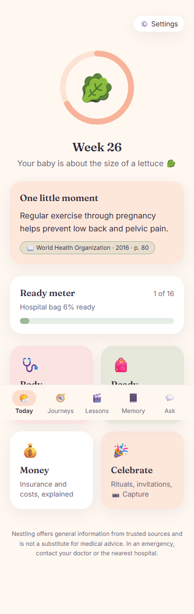
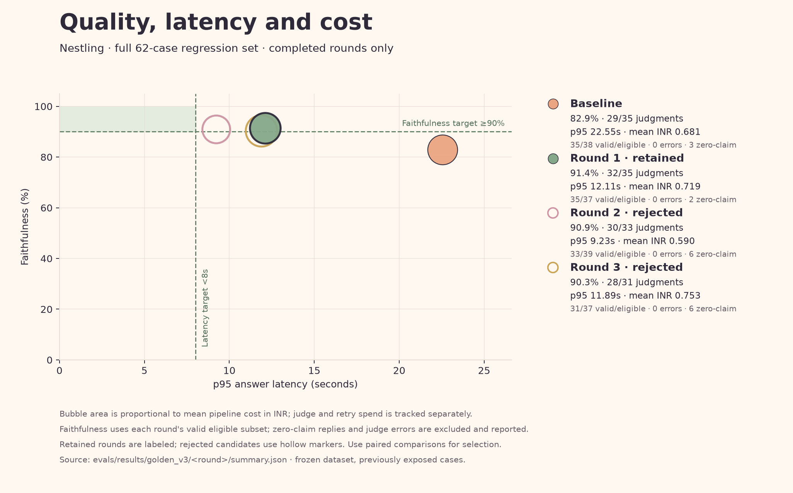
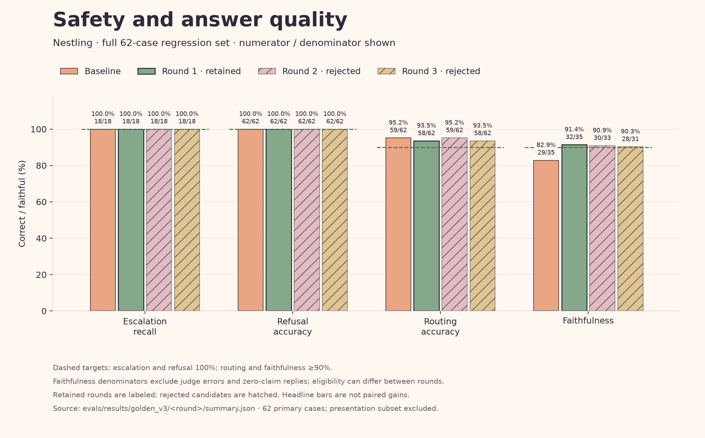
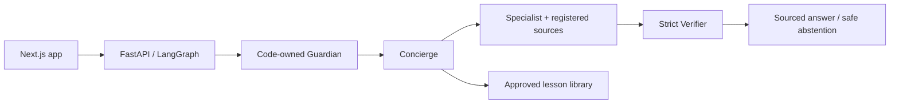

# Nestling
### From bump to baby. Every answer, sourced.

A calm companion for first-time parents in India: trusted answers, pregnancy preparation and reviewed baby-care lessons in one mobile experience.

<p align="center"></p>

**Demo:** local app · **Loom:** owner recording pending · [Submission report](docs/week4_report.md)

## Why Nestling

- **Sourced help:** medical, diet and insurance answers cite registered references or acknowledge missing evidence.
- **Safety in code:** deterministic rules own danger-sign escalation, with no diagnosis or medicine doses.
- **Reviewed lessons:** 12 approved videos cover newborn care and before-birth preparation; every scene needs human approval.

## What improved

Frozen **v3, 62 cases**; same inputs, labels, models and independent Qwen judge across four complete runs. Round 1 is retained.

| Measure | Target | Baseline → retained R1 | Status |
|---|---|---|---|
| Danger-sign recall | 100% | 18/18 → 18/18 | ✅ |
| Refusal accuracy | 100% | 62/62 → 62/62 | ✅ |
| Routing | ≥90% | 59/62 → 58/62 (93.55%) | ✅ |
| Judged faithfulness | ≥90% | 29/35 → 32/35 (91.43%) | ✅ |
| p95 response time | <8s | 22.55s → 12.11s | ❌ |
| Mean pipeline cost | <₹2 | ₹0.681 → ₹0.719 | ✅ |

A citation parser truncated a source ID and discarded relevant evidence; fixing it improved paired faithfulness **27/33 → 30/33** and task completion **47/62 → 52/62**. Two later experiments were rejected because useful-answer quality fell, despite some speed gains. Safety held on these test cases; latency still misses target, and human-versus-judge calibration is **pending (0/20)**.




Questions are owner-attested human-authored and reviewed, not independently audited. A retrospective **40-case presentation** accompanies the full62 results; this previously exposed regression set does not establish unseen-case or clinical performance.

## How it works



Nebius: **DeepSeek-V4-Pro** for specialists/verification, **DeepSeek-V4.1-Flash** for classification/routing. **Qwen3-235B** judges offline. Browser-only personal state; app traces hide inputs/outputs.

## Run locally

Python3.12, uv, Node20.9+. Copy `.env.example` to `.env`, fill local keys, then:

```sh
uv sync --locked
uv run uvicorn api.main:app --host 127.0.0.1 --port 8010
```

In another terminal, run `cd web` and `npm ci`. Set the API address before starting:

```powershell
# PowerShell
$env:NEXT_PUBLIC_API_URL="http://127.0.0.1:8010"
npm run dev
```

```sh
# Bash
NEXT_PUBLIC_API_URL=http://127.0.0.1:8010 npm run dev
```

Open **http://localhost:3000**. Approved render files must be copied separately; missing media safely hides lessons.

Next: reduce retrieval/model latency, address incomplete tasks, and complete human calibration. [Evidence checklist](docs/SUBMISSION.md) · [Engineering, QA and rebuild commands](docs/engineering_notes.md) · [Deployment checklist](docs/deploy_checklist.md)
